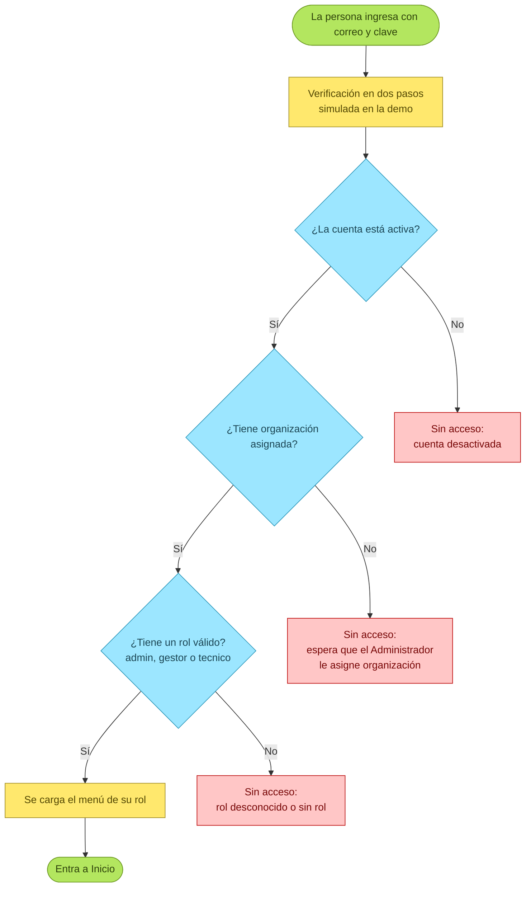
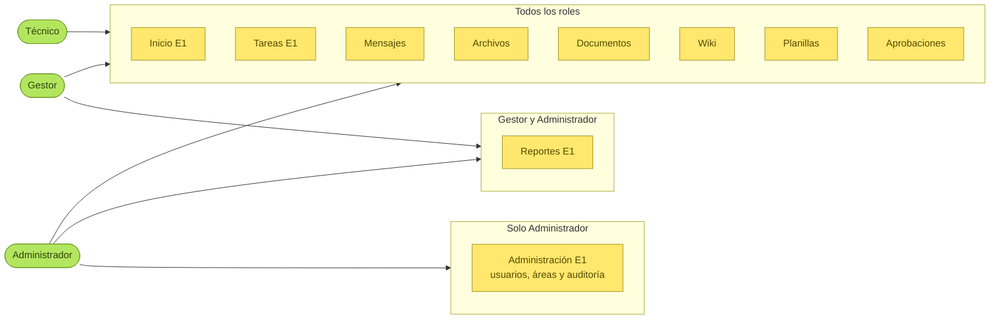
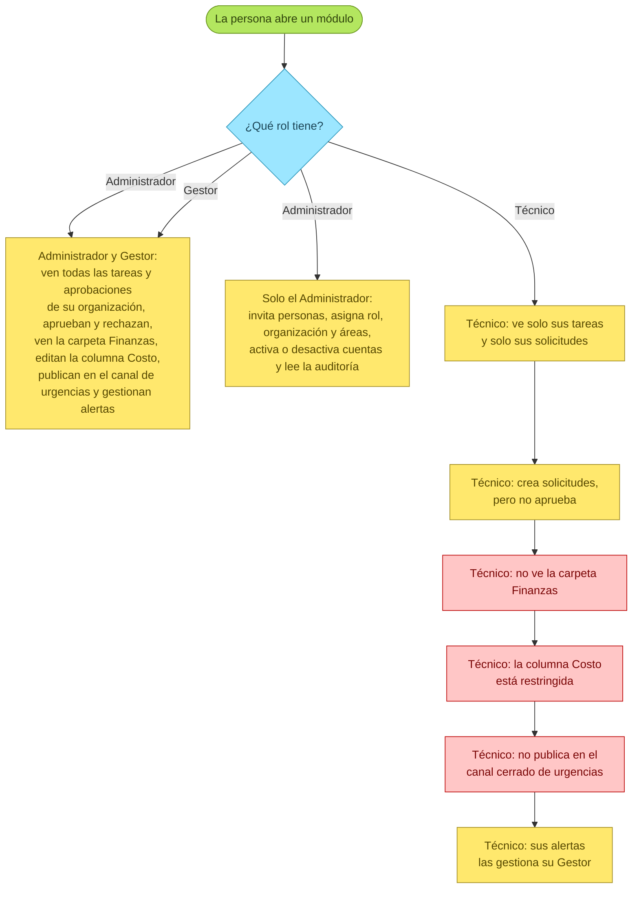
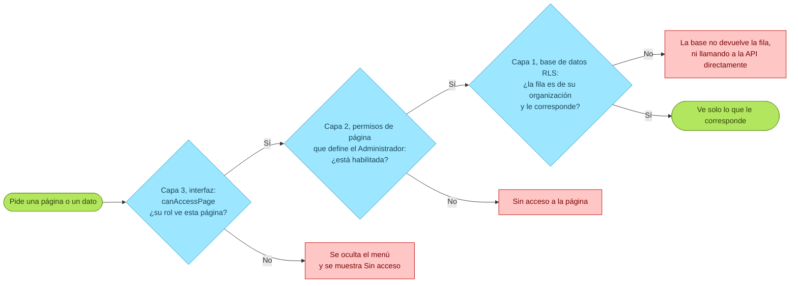
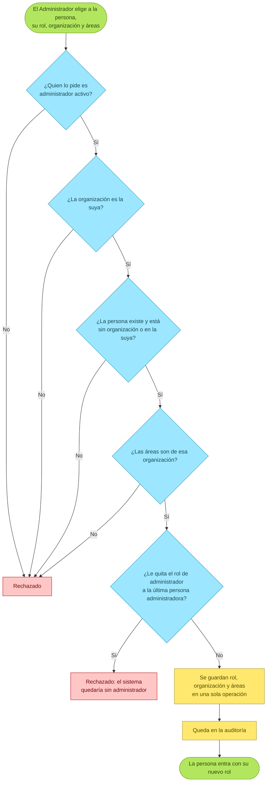

# Diagramas de flujo: permisos por rol

Fuente: [`docs/BASE-DEL-PRODUCTO.md`](../BASE-DEL-PRODUCTO.md) (sección 2, roles) y las migraciones de la Etapa 1 (`starter-kit/supabase/migrations/`, **escritas, aún no aplicadas**). Si cambia un rol o un permiso, se actualiza primero la base y después este archivo (`AGENTE.md`, sección 8). La versión para ver en el navegador o el teléfono es [`permisos-por-rol.html`](permisos-por-rol.html), generada desde este archivo.

Leyenda: verde = inicio o fin, amarillo = paso, celeste = decisión, rojo = sin acceso.

## 1. Entrar a la app y resolver el rol

Fail-closed: ante cualquier duda, la persona queda **sin acceso**.

## 2. Qué módulos ve cada rol

Administrador: 10 módulos. Gestor: 9. Técnico: 8. Los marcados con **E1** son de la Etapa 1 (ADR-0002); el resto es Etapa 2.

## 3. Qué cambia dentro de cada módulo según el rol

## 4. Las tres capas que deciden un acceso

Solo la base de datos (RLS) cuenta como seguridad: las otras dos capas ordenan lo que se muestra.

## 5. El Administrador asigna o cambia un rol

Así funciona la función `admin_assign_member` de la Etapa 1. Una persona tiene **un solo** rol; cambiarlo actualiza su fila.

