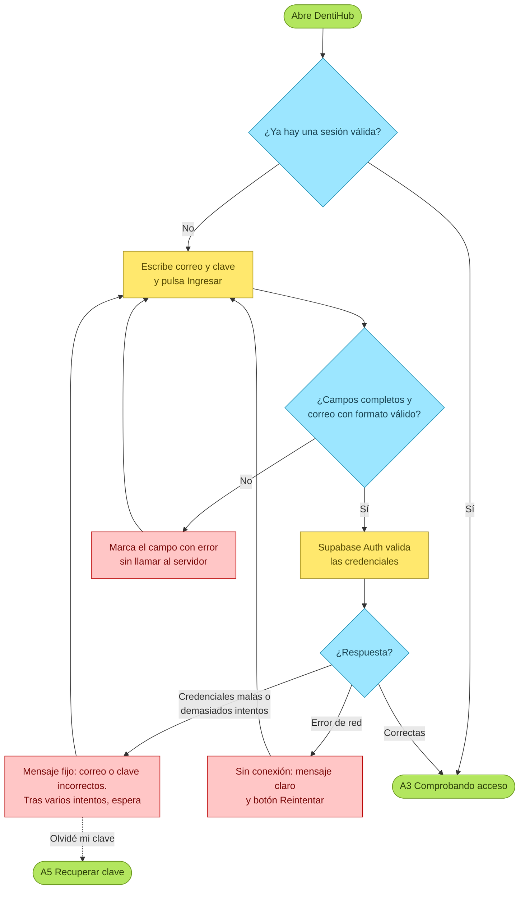
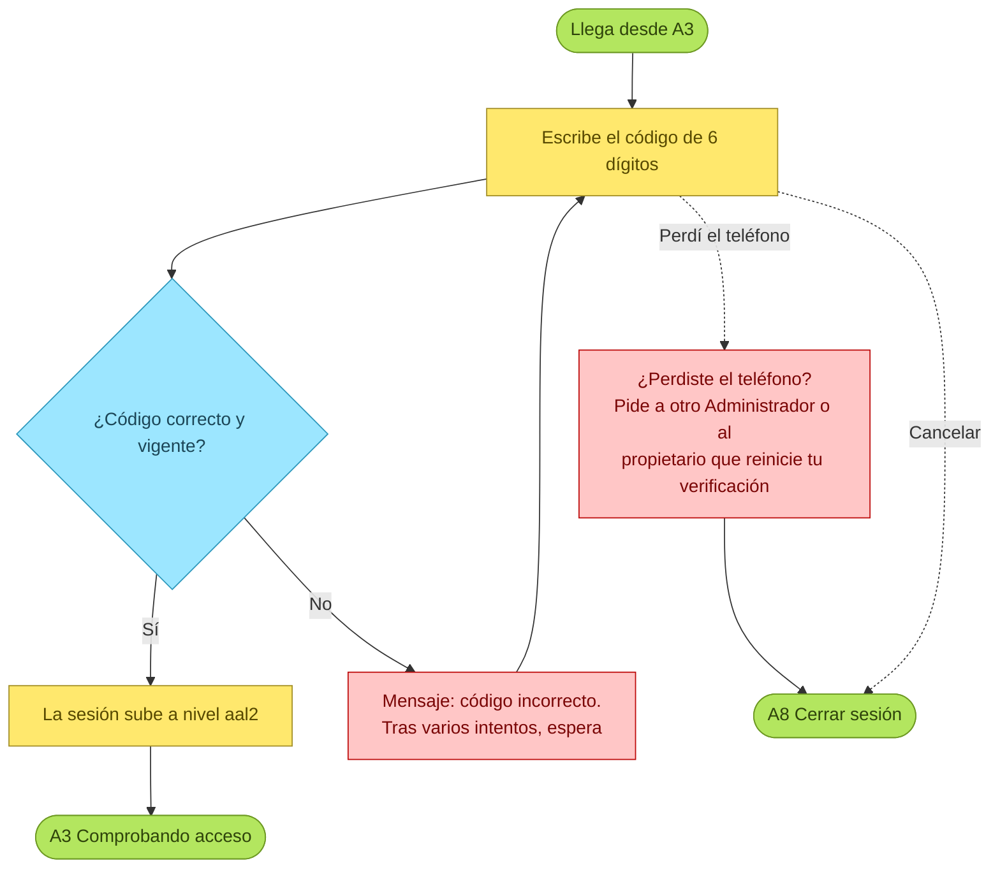
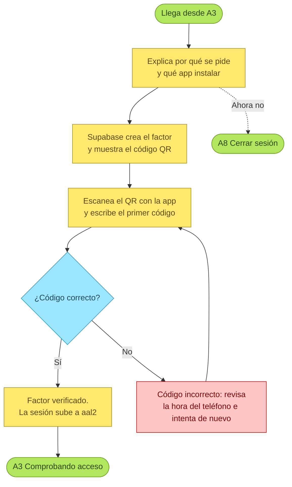
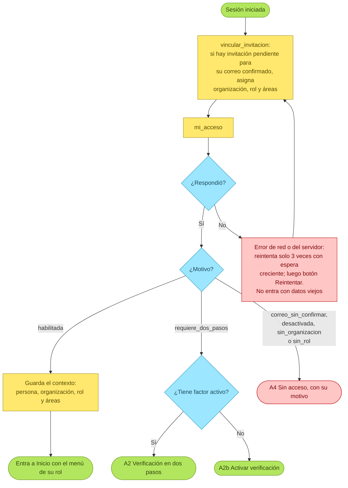
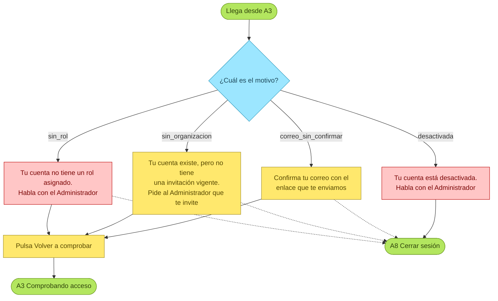
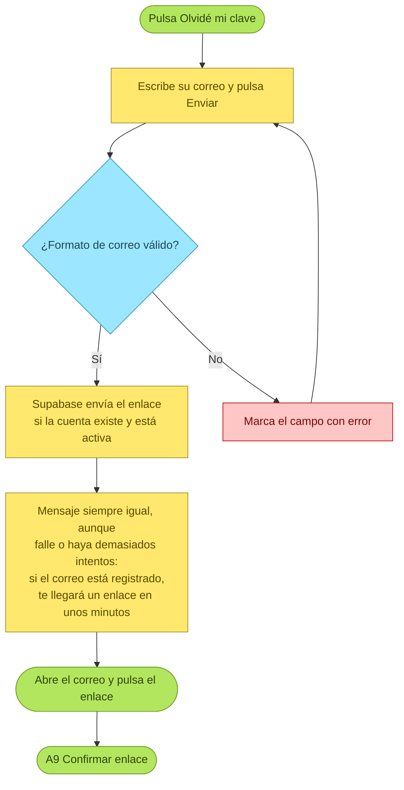
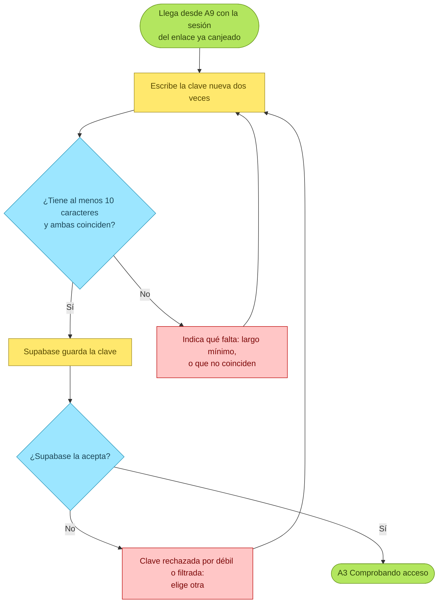
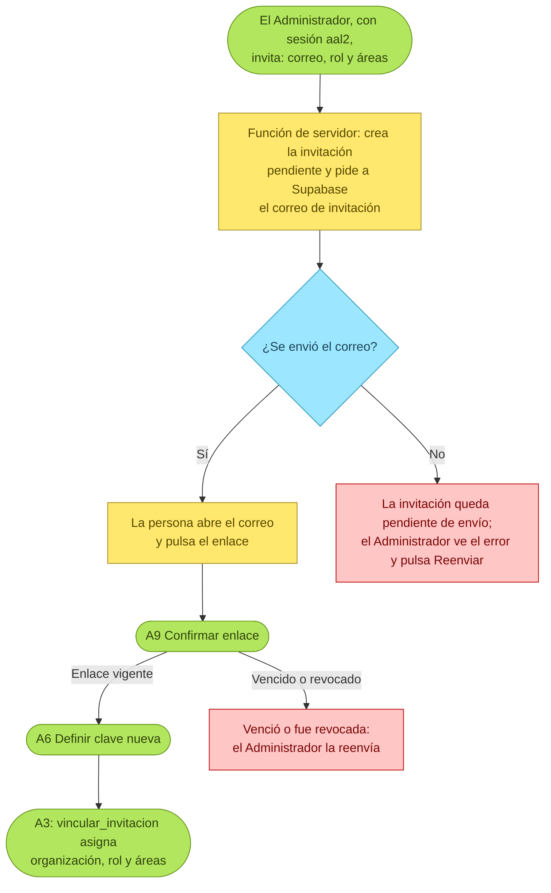
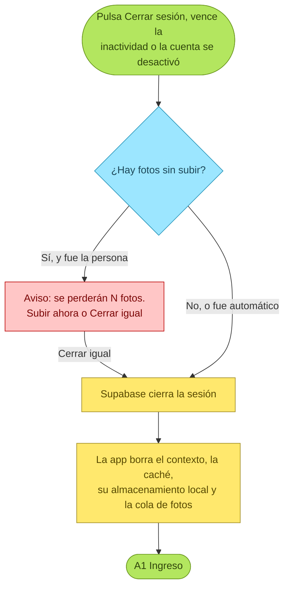
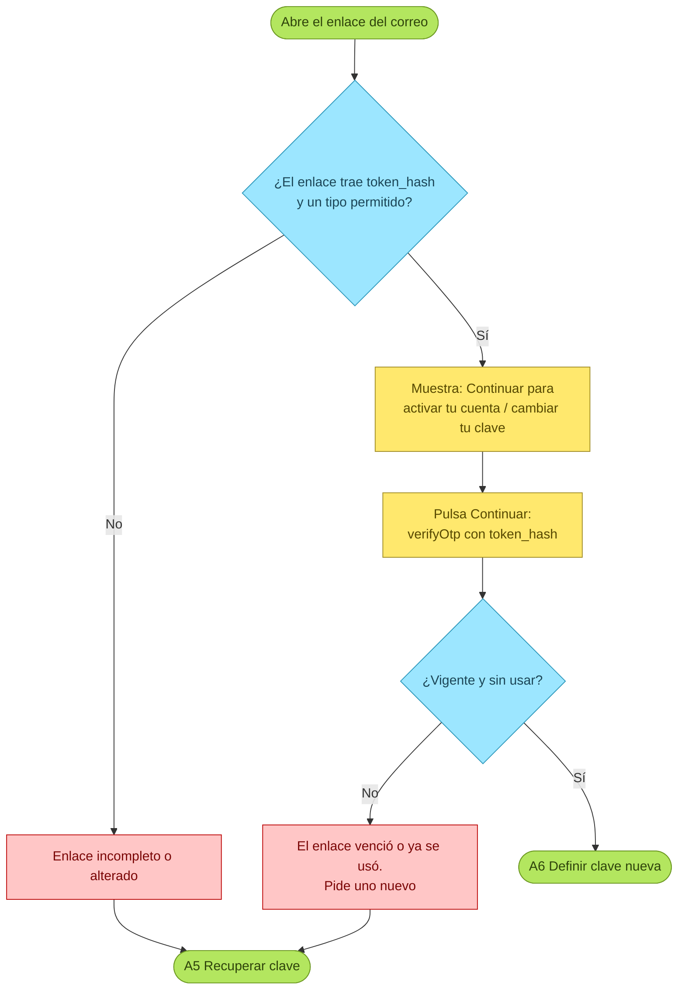

# Módulo 1: Acceso

**Qué resuelve:** certificar **quién es la persona**, **qué cuenta usa** y **si está habilitada**, con Supabase Auth y la base de datos. **Entrega** el contexto de acceso a los demás módulos ([contrato](README.md#contrato-central-el-contexto-de-acceso)).

Las decisiones y la auditoría que dieron forma a este flujo están en el [ADR-0005](../adr/0005-base-de-verificacion-acceso.md) (2026-11-12). Se construye con el [prompt de la base de verificación](../prompts/01-base-de-verificacion.md).

**Reglas que no se negocian**
- **Sin registro abierto:** se entra solo por invitación, y la invitación ya trae la organización, el rol y las áreas.
- **El rol y la organización nunca salen de datos que escribe la propia persona.** Se leen de la base en cada consulta y nunca desde el token de sesión.
- **Fail-closed:** si algo no se puede comprobar, la persona queda sin acceso. Un error de red no es una denegación: se reintenta.
- **Verificación en dos pasos obligatoria para Administradores, exigida por la base de datos.** Sin ella, un Administrador no tiene ningún permiso.
- **Los mensajes no revelan si un correo existe**, tampoco cuando Supabase responde «demasiados intentos».
- **Los enlaces de los correos no se gastan al abrirse.** Se canjean al pulsar «Continuar» en A9, así los antivirus de correo no los consumen.
- **Las claves nunca pasan por el chat, el código ni Git.**

**Pantallas:**
- A1 Ingreso
- A2 Verificación en dos pasos
- A2b Activar verificación
- A3 Comprobando acceso
- A4 Sin acceso
- A5 Recuperar clave
- A6 Definir clave nueva
- A7 Aceptar invitación
- A8 Cerrar sesión
- A9 Confirmar enlace

Leyenda de los flujos: verde = inicio o fin, amarillo = paso, celeste = decisión, rojo = sin acceso o error.

## A1. Ingreso

Correo y clave. Supabase Auth valida las credenciales (`signInWithPassword`).

A1 no decide nada sobre la verificación en dos pasos. Eso lo decide **A3**, con lo que responde la base, para que no exista un camino que la salte.

## A2. Verificación en dos pasos

Código de 6 dígitos de una app autenticadora (Supabase MFA, factor TOTP). Sube la sesión al nivel `aal2`. Se llega desde A3 cuando la base responde `requiere_dos_pasos` y la persona **ya tiene** un factor activo.

## A2b. Activar verificación

Primer ingreso de un Administrador, o después de que se reinició su verificación. Se llega desde A3 con `requiere_dos_pasos` y **sin** un factor activo.

Si se abandona a medias, el factor queda sin verificar y se reemplaza en el siguiente intento. No quedan factores huérfanos.

## A3. Comprobando acceso

Pantalla de carga breve y el **único** lugar donde se arma el contexto de acceso. Hace dos llamadas:
1. `vincular_invitacion()`: aplica la invitación pendiente, si existe. Es idempotente.
2. `mi_acceso()`: lee el contrato.

**Mientras la persona usa la app:** el contexto se vuelve a pedir al volver a la pestaña, cada 5 minutos y ante cada evento de sesión de Supabase (renovación, cierre en otra pestaña). Si el Administrador la desactiva:
- la base deja de entregarle datos **en la siguiente consulta** (RLS);
- Auth bloquea la renovación de la sesión;
- la app la lleva a A4 en la siguiente comprobación.

Si la organización tiene configurado un **cierre por inactividad** (`idle_timeout_minutes`), pasado ese tiempo sin uso se va a A8.

## A4. Sin acceso

Cuatro variantes con el mismo diseño: título, explicación corta, qué hacer y botón **Cerrar sesión**.

Con las invitaciones, «sin organización» deja de ser el camino normal. Solo aparece si se creó una cuenta por fuera de una invitación, o si la invitación se revocó antes de usarse.

## A5. Recuperar clave

Una cuenta bloqueada en Auth no recibe el enlace, y la pantalla muestra el mismo mensaje fijo.

## A6. Definir clave nueva

Se llega desde A9, con un enlace de recuperación (A5) o de invitación (A7) ya canjeado.

## A7. Aceptar invitación

El Administrador invita desde Administración con **correo, rol y áreas**. Una **función de servidor** registra la invitación en la base y pide a Supabase que envíe el correo. La clave de servicio nunca va en el navegador.

Reglas de la invitación:
- **Vigencia:** 7 días.
- **Una pendiente por correo** en la organización.
- **El Administrador puede** reenviarla y revocarla.
- **La vinculación exige el correo confirmado**, que se confirma al canjear el enlace.
- **Una invitación revocada no vincula**, aunque la cuenta ya exista en Auth.

## A8. Cerrar sesión

En un cierre automático (por inactividad o por desactivación) no hay a quién preguntar. Las fotos pendientes se descartan, y eso queda registrado.

## A9. Confirmar enlace

Página intermedia para **todos** los enlaces de correo (invitación y recuperación). El enlace trae un `token_hash` que **no se canjea al abrir la página**: se canjea al pulsar el botón. Así, los antivirus y vistas previas de correo que abren enlaces no lo gastan.

Los tipos permitidos son `invite` y `recovery`. Cualquier otro valor se trata como enlace alterado.

## Datos y funciones que usa

- **Supabase Auth:**
  - ingreso con clave;
  - MFA con factor TOTP (inscribir, desafiar y verificar);
  - recuperar y cambiar clave;
  - invitación y bloqueo (`ban_duration`), ambos solo desde funciones de servidor.
- **Base de datos (migraciones de la Etapa 1, escritas y sin aplicar):**
  - `profiles` (`active`, `org_id`);
  - `user_roles` (un rol por persona);
  - `user_areas`;
  - `auth_org()` y `auth_role()`.
- **Por preparar (ADR-0005):**
  - Tabla `invitations` y su política RLS.
  - Funciones `admin_create_invitation`, `admin_revoke_invitation`, `vincular_invitacion()` y `mi_acceso()`.
  - `auth_role()` con la exigencia de `aal2` para Administradores.
  - Columna `organizations.idle_timeout_minutes`.
  - Funciones de servidor `invitar` y `bloquear-cuenta`.
  - Configuración de Auth: SMTP, plantillas en español con `{{ .TokenHash }}`, URLs exactas, sin registro público ni ingreso anónimo, y la persona no cambia su propio correo.

## Terminado cuando

1. Una persona invitada pulsa el enlace (aunque un antivirus lo haya abierto antes), define su clave, entra y ve el menú de su rol sin que nadie le asigne nada a mano.
2. Una cuenta desactivada, sin organización, sin rol o con el correo sin confirmar ve la variante correcta de A4 y no lee ningún dato, **ni llamando a la API directamente**.
3. Un Administrador con solo la clave (sesión `aal1`) no puede leer ni escribir nada de administración ni de operación, **ni por la API**.
4. Recuperar la clave nunca revela si un correo existe, tampoco ante el límite de intentos.
5. Desactivar una cuenta corta los datos en la siguiente consulta e impide renovar la sesión. Reactivarla devuelve el acceso.
6. Cerrar sesión borra la caché y el almacenamiento local: otra persona en el mismo teléfono no ve nada de la anterior. Si había fotos sin subir, se avisó antes.
7. Un error de red en A3 nunca saca a la persona a A4 ni la deja entrar con un contexto viejo.
8. Existen y se probaron los procedimientos de arranque (primera organización y primer Administrador) y de recuperación de un Administrador que perdió su teléfono.

## Decisiones abiertas

- **Plan de Supabase:** Pro agrega bloqueo de claves filtradas y límite de sesiones por inactividad en el servidor.
- **Proveedor de envío de correo** (Resend o SendGrid) y quién configura el DNS en la empresa cliente.
- **Ingreso por teléfono:** solo si se suma personal sin correo. Hoy no se construye.
