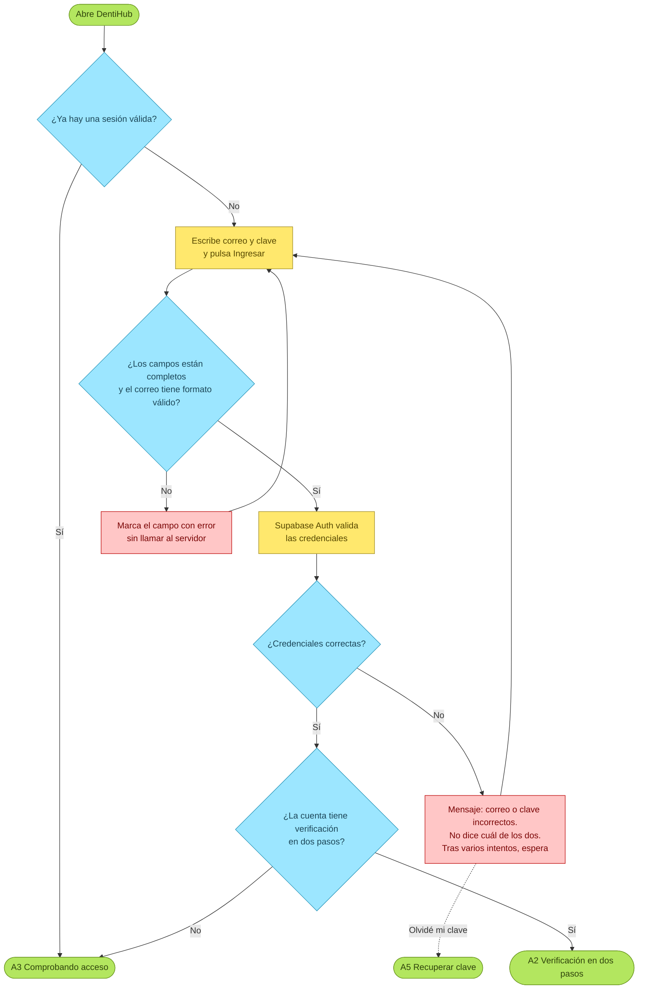
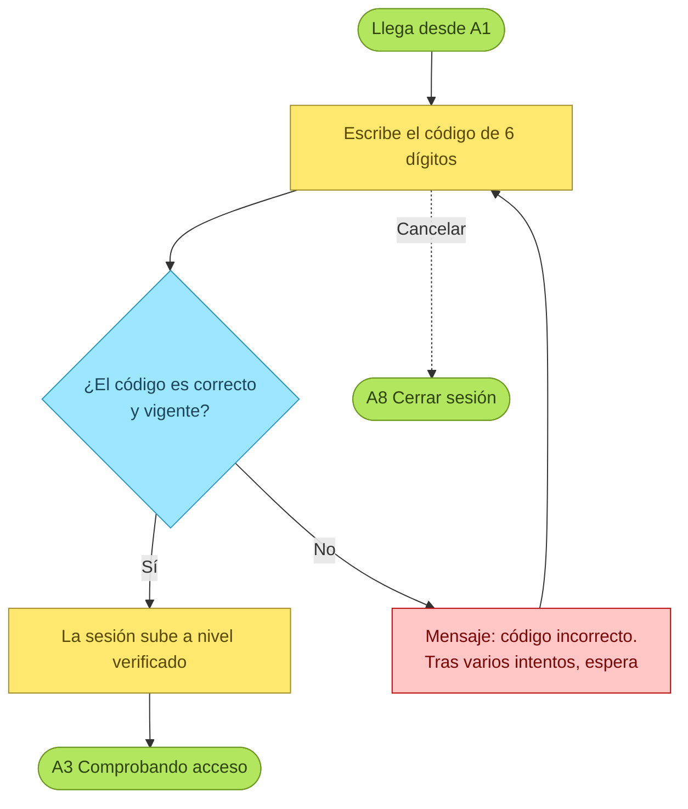
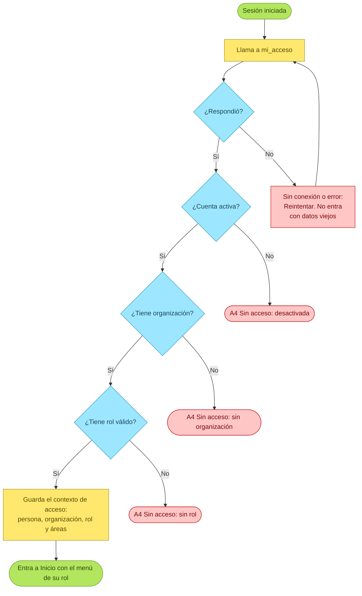
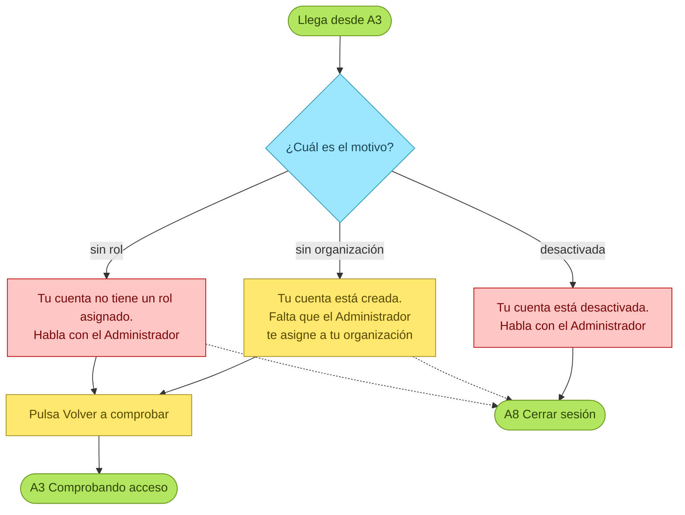
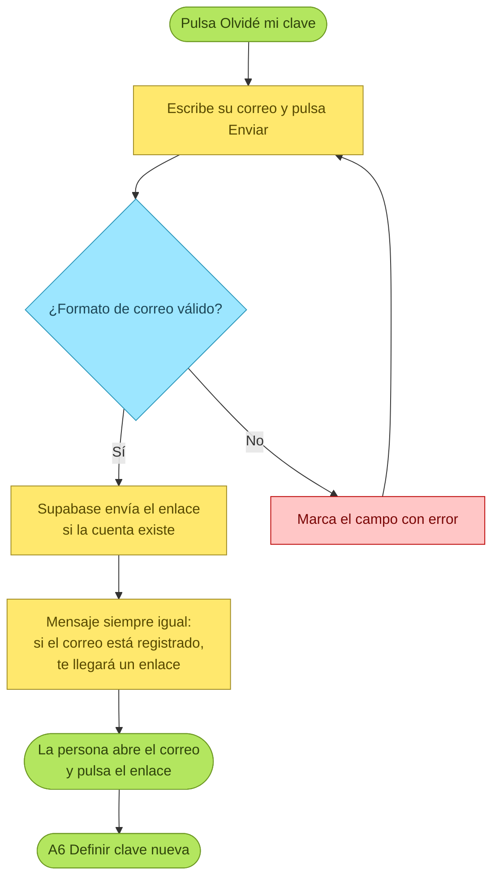
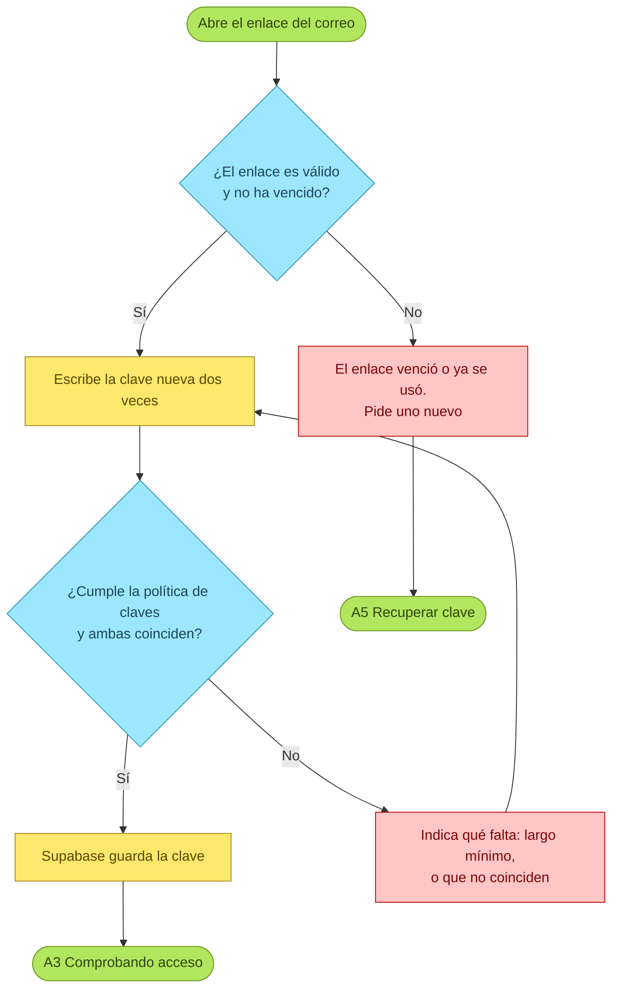
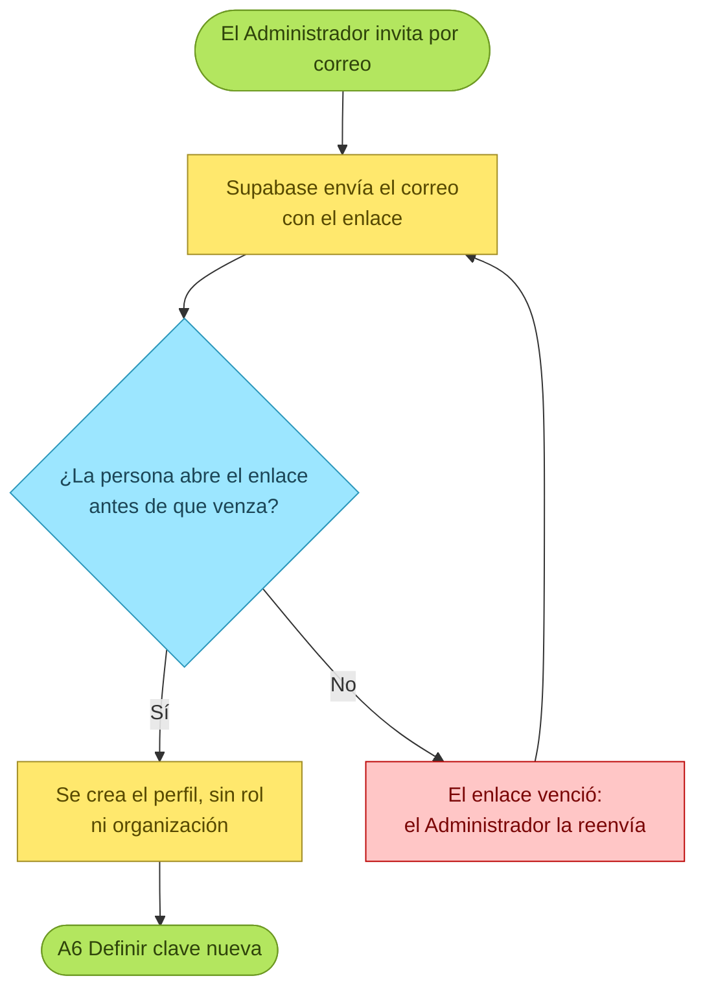
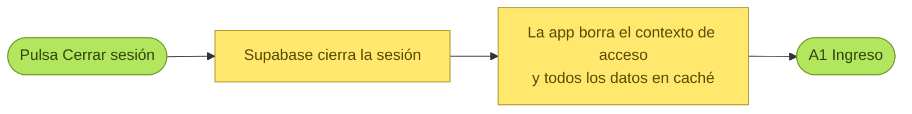

# Módulo 1: Acceso

**Qué resuelve:** certificar **quién es la persona**, **qué cuenta usa** y **si está habilitada**, usando Supabase Auth y la base de datos. **Entrega** el contexto de acceso a los demás módulos ([contrato](README.md#contrato-central-el-contexto-de-acceso)).

**Reglas que no se negocian**
- No hay registro abierto: se entra solo por invitación.
- El rol y la organización nunca salen de datos que escribe la propia persona; los asigna un administrador.
- Fail-closed: si algo no se puede comprobar, la persona queda sin acceso.
- Los mensajes de error no revelan si un correo existe.
- Las claves nunca pasan por el chat, el código ni Git.

**Pantallas:** A1 Ingreso · A2 Verificación en dos pasos · A3 Comprobando acceso · A4 Sin acceso · A5 Recuperar clave · A6 Definir clave nueva · A7 Aceptar invitación · A8 Cerrar sesión.

Leyenda de los flujos: verde = inicio o fin, amarillo = paso, celeste = decisión, rojo = sin acceso o error.

## A1. Ingreso

Correo y clave. Supabase Auth valida las credenciales (`signInWithPassword`).

## A2. Verificación en dos pasos

Código de 6 dígitos de una app autenticadora (Supabase MFA). En la demo es simulada. **Por decidir:** obligatoria para Administradores (recomendado) u opcional para todos.

## A3. Comprobando acceso

Pantalla de carga breve. Llama a `mi_acceso()` y decide adónde va la persona. Es el **único** lugar donde se arma el contexto de acceso.

**Mientras la persona usa la app:** el contexto se vuelve a pedir al volver a la pestaña y cada pocos minutos. Si el Administrador la desactiva, en la siguiente comprobación pasa a A4; aunque la interfaz tarde, la base de datos ya le niega los datos (RLS).

## A4. Sin acceso

Tres variantes con el mismo diseño: título, explicación corta, qué hacer y botón **Cerrar sesión**.

## A5. Recuperar clave

## A6. Definir clave nueva

Se llega desde el enlace de recuperación (A5) o de invitación (A7).

## A7. Aceptar invitación

La invitación la envía el Administrador desde el módulo Administración, mediante una **función de servidor** (la clave de servicio nunca va en el navegador).

Después de A6 la persona pasa por A3. Si el Administrador todavía no le asignó organización y rol, ve A4 «sin organización» hasta que lo haga.

## A8. Cerrar sesión

## Datos y funciones que usa

- **Supabase Auth:** ingreso con clave, verificación en dos pasos, recuperar y cambiar clave, invitación (desde una función de servidor).
- **Base de datos:** `profiles` (`active`, `org_id`), `user_roles` (un rol por persona), `user_areas`. Migraciones de la Etapa 1, escritas y **sin aplicar**.
- **Por preparar:** la función `mi_acceso()` del contrato, la función de servidor que invita, y la configuración de Supabase: registro público desactivado, política de claves, URLs de redirección y plantillas de correo en español.

## Terminado cuando

1. Una persona invitada define su clave, entra y ve el menú de su rol.
2. Una cuenta desactivada, sin organización o sin rol ve la variante correcta de A4 y no lee ningún dato, **ni llamando a la API directamente**.
3. Recuperar clave nunca revela si un correo existe.
4. Cerrar sesión borra la caché: otra persona en el mismo teléfono no ve nada del anterior.
5. Con verificación en dos pasos activa, no se entra sin el código.

## Decisiones abiertas

- Verificación en dos pasos: ¿obligatoria para Administradores?
- Política de claves (largo mínimo; Supabase Pro agrega bloqueo de claves filtradas).
- Cada cuánto se vuelve a comprobar el acceso mientras la app está abierta.
