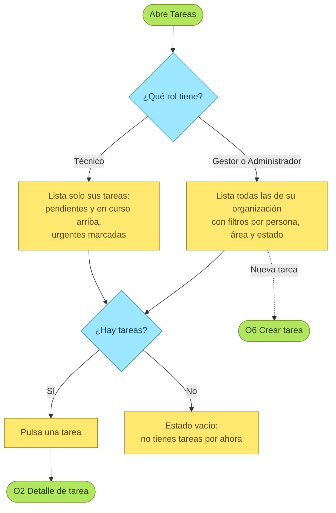
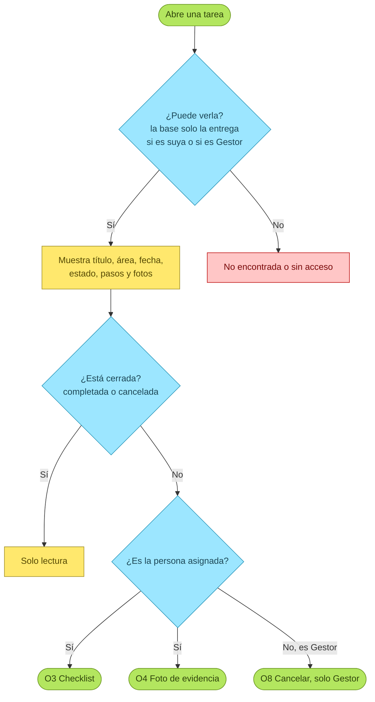
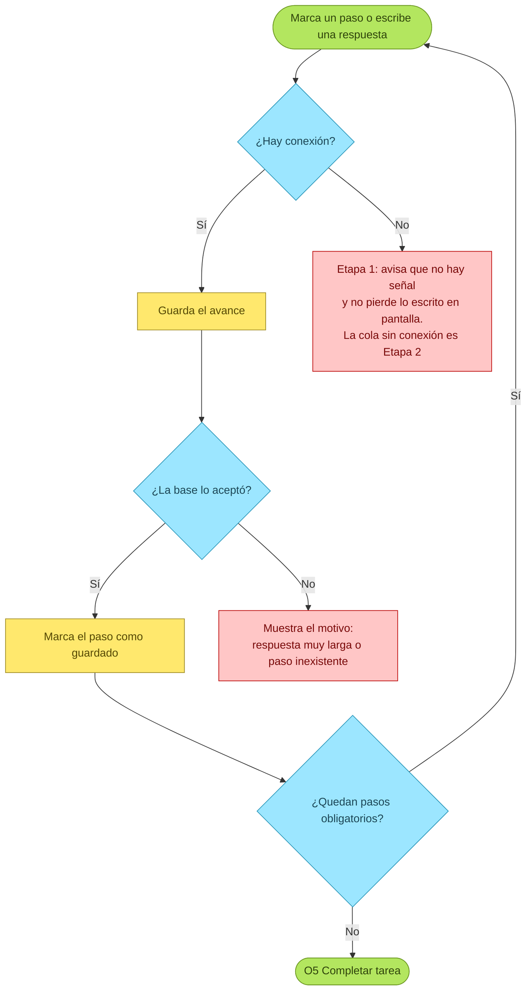
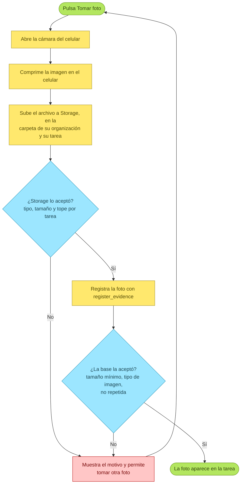
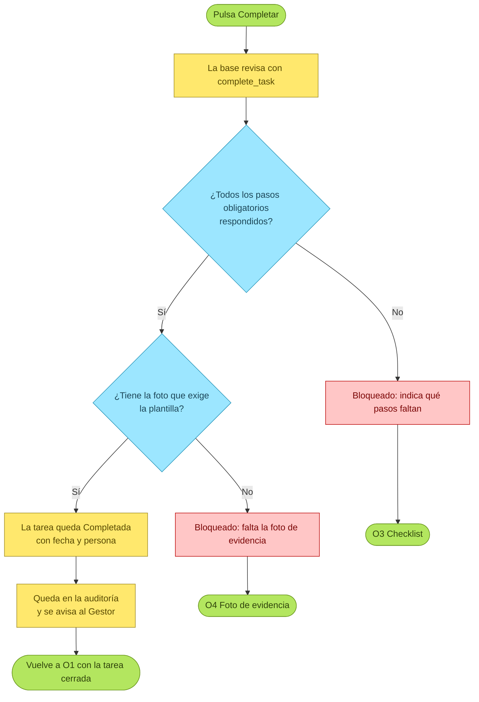
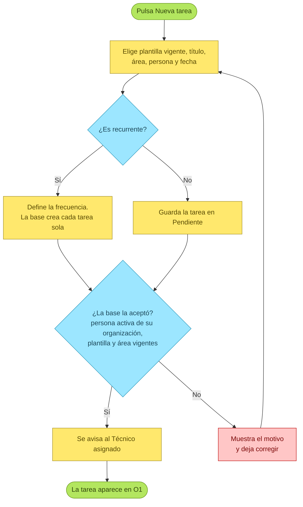
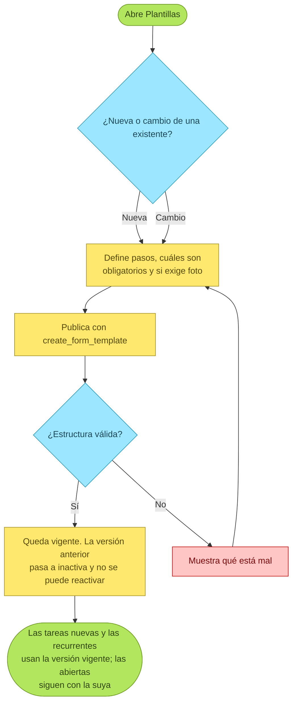
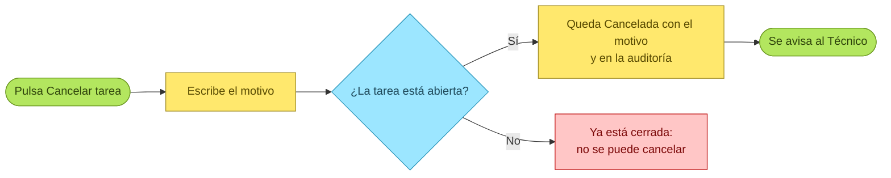

# Módulo 3: Operación (tareas, checklist y evidencia)

**Qué resuelve:** el trabajo de terreno de la Etapa 1. El Gestor crea y asigna tareas con su checklist; el Técnico las hace desde el celular, marca los pasos, toma la foto de evidencia y la cierra. **Consume** el contexto de acceso del [módulo Acceso](01-acceso.md) y las personas habilitadas del módulo Administración.

**Reglas que no se negocian**
- El Técnico ve y trabaja **solo sus tareas**; Gestor y Administrador ven todas las de su organización.
- Una tarea **no se cierra** sin todos los pasos obligatorios y sin la foto cuando la plantilla la exige. Lo impone la base de datos (`complete_task`), no solo la pantalla.
- El estado de una tarea solo cambia con las funciones de tareas; nadie lo edita directo.
- Una plantilla no se edita: se publica una versión nueva. Las tareas abiertas siguen con su versión.

**Pantallas:** O1 Mis tareas · O2 Detalle de tarea · O3 Checklist · O4 Foto de evidencia · O5 Completar tarea · O6 Crear o asignar tarea (Gestor) · O7 Plantillas (Gestor) · O8 Cancelar tarea (Gestor).

Leyenda de los flujos: verde = inicio o fin, amarillo = paso, celeste = decisión, rojo = error o bloqueo.

## O1. Mis tareas

## O2. Detalle de tarea

## O3. Checklist

Cada cambio se guarda con `save_task_progress`. La primera respuesta pasa la tarea de **Pendiente** a **En curso**.

## O4. Foto de evidencia

Reintentar la misma subida no duplica la foto: cada una lleva un identificador creado en el celular.

## O5. Completar tarea

## O6. Crear o asignar tarea (Gestor)

## O7. Plantillas (Gestor)

## O8. Cancelar tarea (Gestor)

## Datos y funciones que usa

Migraciones de la Etapa 1, escritas y **sin aplicar**: `form_templates`, `task_definitions`, `tasks`, `task_evidence`, bucket privado `evidence`; funciones `create_form_template`, `save_task_progress`, `register_evidence`, `complete_task`, `cancel_task`, `generate_recurring_tasks`. Los avisos al Técnico y al Gestor dependen del módulo transversal de notificaciones, **por diseñar**.

## Terminado cuando

1. El Gestor asigna un checklist recurrente y la tarea aparece sola cada día.
2. El Técnico la completa con foto desde el celular; sin foto o sin pasos, no se cierra, **ni llamando a la API directamente**.
3. Un Técnico no ve ni abre tareas o fotos de otra persona.
4. Todo cambio de estado queda en la auditoría.

## Decisiones abiertas

- Cuántas fotos exige cada plantilla por defecto (hoy: lo define cada plantilla).
- Si el Gestor puede completar una tarea en nombre del Técnico (las migraciones lo permiten; la foto solo la sube el asignado).
- Reabrir una tarea cerrada (hoy no existe).
