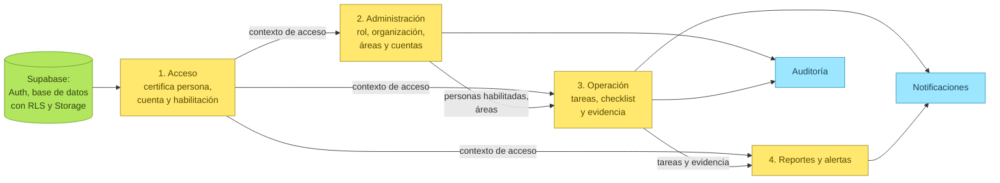

# Módulos de DentiHub y cómo se conectan

Decisión: [ADR-0003](../adr/0003-construccion-por-modulos.md). Alcance: Etapa 1, app de terreno ([ADR-0002](../adr/0002-alcance-etapa-1-app-de-terreno.md)).

Cada módulo se diseña, construye y prueba por separado, y cada pantalla tiene su propio flujo. Los módulos solo se hablan a través de **contratos** (qué entrega cada uno y qué consume), nunca leyendo las tablas internas de otro.

## Mapa

## Módulos

- **1. Acceso** · [01-acceso.md](01-acceso.md) · Ingreso, verificación en dos pasos, recuperar clave, aceptar invitación y pantallas de «sin acceso». **Entrega** el contexto de acceso.
- **2. Administración** · documento pendiente · Asignar rol, organización y áreas; listar cuentas sin asignar; activar y desactivar; ver auditoría. **Consume** el contexto de acceso (solo Administrador).
- **3. Operación** · [03-operacion.md](03-operacion.md) · Mis tareas, detalle, checklist, foto de evidencia y cierre; para Gestor, crear y asignar tareas y plantillas. **Consume** el contexto de acceso y las personas habilitadas.
- **4. Reportes y alertas** · documento pendiente · Cumplimiento por persona, área y periodo; alertas simples. **Consume** tareas y evidencia.
- **Transversales:** notificaciones (dentro de la app, correo y push) y auditoría (de solo inserción). Las usan todos los módulos.

## Contrato central: el contexto de acceso

Lo entrega **Acceso** después de certificar a la persona. Ningún otro módulo vuelve a decidir quién es ni qué rol tiene.

- **Datos:** `user_id`, `nombre`, `org_id`, `rol` (`admin`, `gestor` o `tecnico`), `areas`, `habilitada` (cuenta activa, con organización y con rol) y `motivo` cuando no lo está (`desactivada`, `sin_organizacion` o `sin_rol`).
- **Cómo se obtiene:** una función de base de datos `mi_acceso()` que lee perfil, rol y áreas de quien llama (**por preparar**: hoy existen `auth_org()` y `auth_role()` en las migraciones de la Etapa 1, sin aplicar).
- **En la app:** un hook `useAcceso()` (TanStack Query, llave estable `["acceso"]`) que se invalida al iniciar o cerrar sesión.
- **Regla:** si `habilitada` es falso, la app solo muestra las pantallas de «sin acceso» del módulo Acceso. La seguridad real sigue en RLS: este contrato ordena la interfaz, no protege los datos.

## Cómo se agrega o cambia un módulo

1. Se escribe o actualiza su documento (pantallas, un flujo por pantalla, datos, contrato).
2. Si cambia un contrato, se actualizan los módulos que lo consumen en el mismo cambio.
3. Se sigue la regla de sincronización de `AGENTE.md` (sección 8): primero `docs/BASE-DEL-PRODUCTO.md`, después lo demás.
